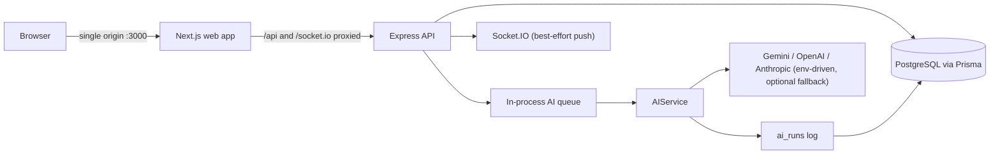
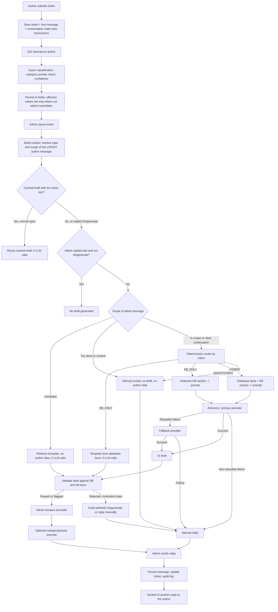

# BookLeaf Author Support & Communication Portal

A full-stack web application that helps a self-publishing company answer author support queries faster and more consistently. Authors log in, see their books and raise tickets; the operations team triages a queue with AI-assisted classification, priority scoring and drafted replies that are grounded in real author data and the company Knowledge Base.

> **Confidential assignment.** This project was built for the BookLeaf Publishing 5-day technical assignment (Full-Stack Developer, "Assignment 1 of 2: Author Support & Communication Portal"). The brief asks that the solution is **not** shared publicly, so keep the repository private. The brief itself is not reproduced here; requirements are paraphrased.

## Status at a glance

| Area | State |
|---|---|
| Source code for both portals, API, AI pipeline, realtime, Docker | **Written** (see the feature table) |
| 31 pure-logic unit tests (routing, topic/scope, facts, validation, parsers, cache fingerprint) | **Run and passing** in the build environment |
| `npm install`, Prisma generate/migrate/seed, real `tsc`, `next build`, Docker build/run, HTTP/auth/RBAC flows, Socket.IO, Swagger UI, browser UI, live LLM calls | **Not executed** in the build environment (no npm registry or Docker access there). Treat them as unverified until you run them |
| Live deployed URL | **Not done** |
| Actual file upload (bonus) | **Not done**; the attachment control is UI-only, as the brief permits |

Exact per-check results (PASS / BLOCKED / NOT RUN) are in [`docs/LOCAL_VERIFICATION.md`](docs/LOCAL_VERIFICATION.md). Nothing in this README claims more than that file does.

## Contents

1. [The problem](#the-problem)
2. [Assignment requirements and how they are met](#assignment-requirements-and-how-they-are-met)
3. [Technology stack](#technology-stack)
4. [Architecture](#architecture)
5. [End-to-end AI pipeline](#end-to-end-ai-pipeline)
6. [Why deterministic routing instead of vector search or RAG](#why-deterministic-routing-instead-of-vector-search-or-rag)
7. [Scenarios and edge cases handled](#scenarios-and-edge-cases-handled)
8. [AI integration details](#ai-integration-details)
9. [Local setup](#local-setup)
10. [Environment variables](#environment-variables)
11. [Demo accounts](#demo-accounts)
12. [API](#api)
13. [Testing](#testing)
14. [Design decisions](#design-decisions)
15. [Limitations and known gaps](#limitations-and-known-gaps)
16. [Repository layout](#repository-layout)

## The problem

BookLeaf processes 1,200+ books a month across a catalogue of 22,000+ titles, with authors in India and the US. Authors ask about royalties, book status, ISBN problems and print quality, and those queries are handled by hand: replies are slow and inconsistent, and the backlog grows at busy times.

The goal is a portal that makes the team faster **without** making authors wrong: a draft that quotes a wrong royalty amount or says an unpublished book is live is worse than a slow reply. So the design treats AI as an assistant to a human reviewer, keeps PostgreSQL as the source of truth for every number, and never lets an AI outage block a ticket.

## Assignment requirements and how they are met

"Implemented" means the code exists and was reviewed. Only the pure-logic parts have been executed (see [Testing](#testing)).

### A. Author portal

| Requirement | Implementation | Status |
|---|---|---|
| Email/password login; each author sees only their own data | bcrypt, HTTP-only session cookie; every author query is scoped by `authorScope`; another author's id returns 404 | Implemented |
| My Books: title, ISBN, genre, publication date, status, MRP, copies sold, royalty earned/paid/pending | `GET /books` (author-scoped) and `frontend/app/author/books`; books in production show "Not applicable yet" for fields that do not exist yet | Implemented |
| Submit a query: book dropdown or "General / Account Level", subject, description, optional attachment | `frontend/app/author/tickets/new`; the attachment control is UI-only with a notice | Implemented (upload not done) |
| My Tickets: status, original query, admin responses, updates without refreshing | list and detail pages; Socket.IO pushes new replies and status changes | Implemented |

### B. Admin portal

| Requirement | Implementation | Status |
|---|---|---|
| Queue filterable by status, category, priority and date; urgent and oldest easy to spot | filters plus urgency ordering (priority, then oldest), a colour edge and an **Overdue** badge after 48 hours | Implemented |
| AI auto-classification into the six categories; admin override | one structured LLM call after the ticket is saved; override sets `categoryOverridden` so a late AI result cannot undo it | Implemented |
| AI priority (Critical / High / Medium / Low); admin override | same call; ISBN issues are floored at High; override sets `priorityOverridden` | Implemented |
| AI-drafted response from the query and the Knowledge Base; editable; sent reply shows on the author's ticket | route, build minimal context, draft, validate, show in an editable composer; sending stores the message and pushes it to the author | Implemented |
| Update status, internal notes (hidden from author), self-assign | `PATCH /admin/tickets/:id`, a separate `ticket_internal_notes` table, `assignedToId: "me"` | Implemented |

### C. API layer

| Requirement | Implementation | Status |
|---|---|---|
| Consistent REST endpoints | everything under `/api/v1`, resource-style naming | Implemented |
| Authentication on all routes | `authenticate` on every router except health, login and logout | Implemented |
| Role-based access; authors own data only, admins everything | `requireAuthor` / `requireAdmin`, ownership filters | Implemented |
| Validation and meaningful errors, not generic 500s | Zod on body, query and params; one `AppError` type and a central error handler with a stable error shape | Implemented |
| API documentation | OpenAPI spec served as Swagger UI at `/api/v1/docs`, plus the table below | Implemented |

### D. AI integration

| Requirement | Implementation | Status |
|---|---|---|
| Prompt engineering using the Knowledge Base and BookLeaf tone | versioned prompts with the tone rules built in and per-category response guidance; the 7 Knowledge Base documents are seeded into the database | Implemented |
| API key security | keys only in backend environment variables; never logged and never sent to the browser | Implemented |
| Graceful degradation | the ticket is committed and acknowledged before any AI work; fallback provider; if all AI fails the admin sees "AI failed" with a retry button and replies manually | Implemented |
| Cost awareness | no LLM for database-only answers, minimal per-intent context, one KB section per category, cached drafts, no auto-regeneration, every call logged in `ai_runs` | Implemented |
| Model choice justified | see [AI integration details](#ai-integration-details). **The deployed model names are for you to record** | Partly: needs your final models |

### Other submission items

| Item | State |
|---|---|
| Provided dataset (10 authors, 18 books) seeded exactly, edge cases included | Implemented (`backend/prisma/seed.ts`, `backend/prisma/data/bookleaf_sample_data.json`) |
| Local run instructions, architecture reasoning, AI approach, API docs, limitations | This README, plus `docs/INTERNAL.md` |
| One-page write-up | `docs/WRITEUP.md` (deployed model names still to fill in) |
| Live URL with seeded data and test credentials | Not done |

A line-by-line matrix is in [`docs/COMPLIANCE.md`](docs/COMPLIANCE.md).

## Technology stack

| Layer | Choice |
|---|---|
| Frontend | Next.js 14 (App Router), React 18, TypeScript, Tailwind CSS 3. Small hand-written UI components, no component library |
| Backend | Node.js 20+, Express 4, TypeScript, Zod for validation and environment parsing |
| Database | PostgreSQL 16, Prisma 6 (schema and a hand-written initial migration) |
| Auth | bcrypt password hashes; a signed session token in an HTTP-only, SameSite=Lax cookie (`Secure` in production) |
| Realtime | Socket.IO on the API's HTTP server, authenticated by the same cookie |
| AI | An in-house `AIService` over plain `fetch` with Gemini, OpenAI and Anthropic providers, chosen by environment variables |
| Logging | pino (JSON, credential redaction, request ids) |
| Security middleware | helmet, express-rate-limit on login, a 100 kb JSON body limit |
| Packaging | Docker and Docker Compose (db, backend, web) |
| API docs | OpenAPI served with swagger-ui-express |
| Tests | Node's built-in test runner via `tsx` |

**Deliberately not used:** Redis, BullMQ, Kafka, any vector database or embeddings, BM25, LangChain or similar frameworks, microservices. Nothing in the requirements justifies them.

## Architecture



- **Single origin.** The browser only talks to the Next.js server, which proxies `/api` and `/socket.io` to the API (`BACKEND_URL`). Cookies are first-party and no CORS configuration is needed.
- **Auth and RBAC.** The session token holds only the user id. Role and active status are re-read from the database on every request, so a deactivated user or a changed role takes effect immediately. Author queries go through `authorScope`; a foreign id returns 404 rather than 403, so ids cannot be probed.
- **AI is decoupled from ticket creation.** `POST /tickets` saves the ticket, its first message and its conversation state in one transaction, returns 201, and only then queues classification. `tickets.aiStatus` (PENDING, PROCESSING, COMPLETED, FAILED) is the job state, and a startup recovery step re-queues work interrupted by a restart. No external queue is needed.
- **Pure logic is separated.** `backend/src/modules/ai/logic/` (routing, topic and scope, facts, templates, validator, parsers, cache fingerprint) imports no Prisma, Express or LLM code, so it is deterministic and unit-tested without a database.
- **Realtime is an enhancement.** Authors join `user:<id>` and admins join `admins`. Events are `ticket:message`, `ticket:updated` and `ticket:created`. If an emit fails the data is already stored, and clients refetch.

## End-to-end AI pipeline

The diagram shows what happens from ticket creation to the author seeing the reply, including the scope gate that stops unrelated messages from reaching author data.



Every provider attempt is written to `ai_runs` (provider, model, prompt version, tokens, latency, status, error, fallback flag).

### How a draft is decided

1. **Scope.** The latest author message is checked first, with a deterministic keyword allow-list and no LLM. A message with no BookLeaf subject matter does not inherit the ticket's old category or intent, and no books, facts or Knowledge Base text are loaded for it.
2. **Intent.** For in-scope messages the intent comes from the first classification. A later message in the same category can refine it. Today the one refinement rule moves a stale `SALES_FIGURES` intent to `ROYALTY_STATUS` when the author starts asking about royalty or payment, and it never moves an intent the other way. A clear topic change resets the intent.
3. **Route.** The intent maps to `DB_ONLY`, `KB_ONLY`, `HYBRID` or `INSUFFICIENT_INFORMATION`.
4. **Context.** Only the fields the intent needs are gathered. Internal notes and contact details are never read.
5. **Draft.** `DB_ONLY` is a template. `KB_ONLY` and `HYBRID` make one LLM call.
6. **Validation.** A deterministic validator checks the draft against the facts before the admin sees it.
7. **Cache.** Drafts are cached by `ticket id + last message id + conversation version + context hash + KB version + prompt version`. The context hash covers the facts plus the effective category, intent, route and scope decision.

## Why deterministic routing instead of vector search or RAG

The Knowledge Base in this system is seven short documents (company overview, royalty policy, ISBN policy, printing and quality, distribution and availability, production stages, general FAQ), and every support category maps to one or two of them. Author-specific answers need exact values (copies sold, royalty pending, payout date, production stage) that live in PostgreSQL rows.

- **Retrieval is a lookup, not a search problem.** The category and intent already tell us which document is relevant, so a mapping table finds it with certainty. Embeddings would add an index, a vector store, an embedding call and a similarity threshold, to rediscover what a `switch` statement already knows, and they would sometimes retrieve the wrong section.
- **Author facts must be exact.** A semantic search over documents cannot produce "BK005: ₹2,546 pending, never paid". A database query can, and the validator can then check the draft against the same values.
- **Cost and latency.** A sales-figure question is answered from a template with no LLM call at all. Where an LLM is used, the prompt carries a few facts and one policy section instead of a retrieved pile of chunks.
- **Predictability and auditability.** The route for a ticket is reproducible: the same ticket state gives the same route, the same cache key and the same context. That makes bugs findable, and it makes the cache key meaningful.
- **Privacy.** Context is chosen by rules, so it is easy to prove that internal notes, other authors' data and contact details are never in a prompt.

**When this would change:** if the Knowledge Base grew to hundreds of free-form documents, or if authors needed answers drawn from long unstructured material, retrieval would become a genuine search problem, and adding it would then be justified. That is not the case in this assignment, and the code keeps retrieval behind a single function (`kbSlugsFor`) so it could be replaced.

## Scenarios and edge cases handled

| Scenario | Behaviour |
|---|---|
| AI provider down, rate-limited or not configured | Ticket still created (201). Admin sees "AI failed" with a retry button and writes the reply manually. With no provider configured the portal runs fully manually |
| Primary provider times out, errors 5xx or returns 429 | Falls back to the secondary provider |
| Invalid API key or bad request (401/403/400/404) | No fallback, by design: it is a configuration problem, not an outage |
| Malformed JSON from the model | One retry on the same provider, then fail |
| Author asks "how many copies have I sold?" | `DB_ONLY`: a template from the database, **no LLM call** |
| Author asks about a royalty not received | `HYBRID`: database facts plus the royalty policy, one LLM call |
| Sales question first, then "How much is my royalty and when will I be paid?" | The stale sales intent is upgraded to `ROYALTY_STATUS`, so the draft includes the policy (quarterly calculation, 45-day payout window, ₹1,000 minimum) |
| Author changes topic ("Forget that. My book is unavailable on Amazon.") | The latest message wins: the category and intent reset to the new topic |
| Unrelated question after a royalty message | Scope gate: a redirect template containing only the author's first name, no book titles, figures or royalty data, and no LLM call |
| Very short or vague follow-up | A clear short continuation ("why?", "any update on that?") keeps the previous topic; anything vaguer goes to manual review with no author data |
| Royalty pending below ₹1,000 (BK016, ₹850) | Facts carry a note that it rolls over to the next quarter |
| Royalty above the threshold and never paid (BK005, ₹2,546) | Facts flag it for investigation; the policy requires an escalation timeline |
| Book still in production (BK013 and another) | My Books shows "Not applicable yet"; facts say no sales, royalties or listings exist; the validator rejects a draft that claims the book is live |
| ISBN problem | Priority floored at High; the draft must state a timeline |
| Draft contradicts the database (wrong amount, copies, date, ISBN or status) | Rejected and withheld from the admin; softer issues are flagged for review |
| Admin replied last | Opening the ticket generates nothing; Regenerate still works |
| Two admins open the same ticket at once | A per-ticket Postgres advisory lock prevents duplicate LLM calls |
| Server restarts during AI work | Startup recovery re-queues classification and marks interrupted drafts failed with a message to Regenerate |
| Admin overrides category or priority | Override flags stop a late AI result from overwriting it; an incompatible AI intent is dropped when the category changes |
| Author replies on a Resolved ticket | Reopened to Open, with no automatic AI draft |
| Author replies on a Closed ticket | 409 with a message to open a new ticket |
| Internal notes | Stored separately; never returned to authors and never sent to an LLM |
| Author A asks for author B's ticket id | 404; admin routes return 403 for authors; no cookie returns 401 |
| Repeated failed logins | 10 failures per IP per 15 minutes, then 429 |
| Long conversation | Beyond 8 messages a rolling summary plus the most recent messages is used instead of the full thread |
| Prompt injection in an author message | Author text is treated as untrusted data in the prompts, and the validator checks the output |

## AI integration details

- **Classification.** One structured call returns `category`, `priority`, `intent` and `confidence`, validated against a schema. Classification runs once per ticket (and again only if an admin asks), not on every message.
- **Providers.** `gemini`, `openai` and `anthropic` sit behind one `LlmProvider` interface using plain HTTPS requests. Configure one provider, or a primary plus a fallback from a different vendor. The REST payloads follow each vendor's public API and have **not been exercised against live endpoints**.
- **Model choice.** The task is short, structured and heavily grounded (facts and policy are supplied in the prompt), so a small, low-cost model per vendor is enough and keeps latency and spend low; the brief itself suggests models in this class. Using a different vendor as the fallback means one vendor's outage does not stop AI assistance. Record the models you deploy in `docs/WRITEUP.md`.
- **Prompts.** Versioned (`CLASSIFICATION_PROMPT_VERSION`, `DRAFT_PROMPT_VERSION`, `SUMMARY_PROMPT_VERSION`) and stored on every run and draft. Bumping a version invalidates cached drafts.
- **Draft validation.** Errors that reject a draft: an amount, copy count, date or ISBN that is not in the database facts; "live" or "published" claims for a book in production; an empty reply. Warnings that flag a draft: a timeline not found in the Knowledge Base, a missing required timeline for ISBN, print or availability issues, no clear next step, an unexpected email address, an overly long reply.
- **Cost controls.** Template answers for database-only questions; minimal per-intent fields; one KB section per category; a recent-message window or rolling summary; draft caching; no generation on refresh; no draft when the admin replied last; FAILED and REJECTED drafts are retried only by an explicit Regenerate; bounded output tokens.

## Local setup

Requirements: Node.js 20 or newer, npm, Docker (for PostgreSQL).

```bash
# 1. Database (bound to 127.0.0.1 only)
docker compose up -d db
#    If port 5432 is already in use:  DB_PORT=5433 docker compose up -d db
#    and use :5433 in DATABASE_URL.

# 2. Backend
cd backend
cp .env.example .env
#    Edit .env: set JWT_SECRET (min 32 chars), SEED_AUTHOR_PASSWORD, SEED_ADMIN_PASSWORD (min 8 chars each).
#    Generate a secret with:  node -e "console.log(require('crypto').randomBytes(48).toString('hex'))"
#    Optional: uncomment AI_PRIMARY_* (and AI_FALLBACK_*) to enable AI.
npm install
npm run db:generate
npm run db:migrate          # applies the initial migration; it should report no drift
npm run db:seed             # 10 authors, 18 books, admin users, 7 Knowledge Base documents
npm run typecheck
npm test
npm run dev                 # API on http://localhost:4000

# 3. Frontend (second terminal)
cd frontend
npm install
npm run typecheck
npm run dev                 # http://localhost:3000, proxies /api and /socket.io to :4000
```

Open <http://localhost:3000>. Swagger UI is at <http://localhost:3000/api/v1/docs>, and the health check is `GET /api/v1/health`.

The portal works without any AI keys: tickets are created and admins reply manually.

### Everything in Docker

```bash
cp backend/.env.example backend/.env     # edit as above (the compose stack runs in production mode,
                                         # which refuses the placeholder JWT secret and seed passwords)
docker compose up --build
```

Services: `db` (PostgreSQL 16), `backend` (applies migrations, seeds because `RUN_SEED=true`, then starts), and `web` (the only published app port, 3000). `COOKIE_SECURE` defaults to `false` in compose for plain-http local use; set it to `true` behind HTTPS.

### Troubleshooting Prisma P1000 (authentication failed)

P1000 means a server answered on that host and port but rejected the credentials. Check in this order:

1. `docker compose ps` shows `db` healthy, and `docker compose exec db psql -U bookleaf -d bookleaf -c '\conninfo'` works.
2. Another PostgreSQL owns port 5432 (a native install is the usual cause): use `DB_PORT=5433` as above.
3. A shell-exported `DATABASE_URL` overrides `.env`: `unset DATABASE_URL`.
4. Special characters in a custom password must be URL-encoded in `DATABASE_URL`.
5. Last resort: the volume was created earlier with a different password. `docker compose down -v` **deletes the local development database**; use it only if that data is disposable.

## Environment variables

Backend variables (see `backend/.env.example`; values are validated at startup and the process refuses to boot on bad configuration).

| Variable | Purpose | Default |
|---|---|---|
| `NODE_ENV` | `development`, `test` or `production` | `development` |
| `PORT` | API port | `4000` |
| `LOG_LEVEL` | pino level | `info` |
| `TRUST_PROXY` | Reverse-proxy hops in front of the API | `0` |
| `DATABASE_URL` | PostgreSQL connection string | required |
| `JWT_SECRET` | Signs session tokens, at least 32 characters; the `replace-with...` placeholder is rejected in production | required |
| `SESSION_TTL_HOURS` | Session lifetime | `168` |
| `COOKIE_SECURE` | Cookie `Secure` flag (`true` or `false`) | true in production, otherwise false |
| `BCRYPT_ROUNDS` | Password hashing cost (10 to 14) | `12` |
| `AI_PRIMARY_PROVIDER` / `AI_PRIMARY_MODEL` / `AI_PRIMARY_API_KEY` | Primary LLM; provider is `gemini`, `openai` or `anthropic`; all three are required together | unset (AI off) |
| `AI_FALLBACK_PROVIDER` / `AI_FALLBACK_MODEL` / `AI_FALLBACK_API_KEY` | Optional fallback LLM, same rules | unset |
| `AI_TIMEOUT_MS` | Per-request provider timeout (1,000 to 120,000) | `25000` |
| `SEED_AUTHOR_PASSWORD` / `SEED_ADMIN_PASSWORD` | Passwords for the seeded demo accounts (seed only, at least 8 characters) | required to seed |
| `RUN_SEED` | Docker only: run the idempotent seed at container start | `true` in compose |

Docker Compose also reads `POSTGRES_USER`, `POSTGRES_PASSWORD`, `POSTGRES_DB` (development defaults are provided), `DB_PORT`, `COOKIE_SECURE` and `TRUST_PROXY`. The frontend takes a build argument, `BACKEND_URL`, which is where the Next.js server proxies `/api` and `/socket.io`.

**Secrets are never committed.** `.env` files are git-ignored; only `backend/.env.example` with placeholders is tracked. API keys stay on the backend.

## Demo accounts

The seed creates one login per author from the provided dataset, using the dataset email, plus two admins. Examples:

| Account | Why it is useful |
|---|---|
| `priya.sharma@email.com` | two published books; the sales-figure (`DB_ONLY`) example |
| `ananya.reddy@email.com` | royalty above the threshold and never paid |
| `kavita.deshmukh@email.com` | pending royalty below the ₹1,000 threshold |
| `sneha.kulkarni@email.com` | a book still in production |
| `admin@bookleaf.example`, `ops@bookleaf.example` | admins |

**The passwords are whatever you set in `SEED_AUTHOR_PASSWORD` and `SEED_ADMIN_PASSWORD`.** They are not stored anywhere in this repository. There is no deployed instance yet, so there are no hosted test credentials to list.

## API

Interactive documentation: `/api/v1/docs` (OpenAPI JSON at `/api/v1/openapi.json`).

| Method and path | Role | Purpose |
|---|---|---|
| `POST /auth/login`, `POST /auth/logout`, `GET /auth/me` | public / any | Session |
| `GET /books` | author | Own books |
| `GET /tickets`, `POST /tickets` | author | List own tickets; create a ticket |
| `GET /tickets/:id`, `POST /tickets/:id/messages` | author | Own ticket detail; follow-up reply |
| `GET /admin/tickets` | admin | Queue with filters, sorting and pagination |
| `GET /admin/tickets/:id`, `PATCH /admin/tickets/:id` | admin | Detail; status, category and priority override, assignment |
| `POST /admin/tickets/:id/messages` | admin | Reply to the author |
| `POST /admin/tickets/:id/notes` | admin | Internal note |
| `GET /admin/tickets/:id/draft` | admin | AI draft (cached) |
| `POST /admin/tickets/:id/draft/regenerate` | admin | Explicit regenerate |
| `POST /admin/tickets/:id/classify` | admin | Retry classification |
| `GET /health` | public | Liveness and database check |

Errors always have the shape `{ "error": { "code", "message", "details?", "requestId" } }` with meaningful statuses (400, 401, 403, 404, 409, 429, 503). Unexpected failures return a generic 500 and are logged with the request id.

## Testing

```bash
cd backend
npm test        # node --test via tsx; no database, network or LLM needed
```

The 31 tests in `backend/tests/logic.test.ts` cover the deterministic AI logic:

- routing for each intent, including no-books cases, and the category-to-KB mapping;
- topic change, the royalty intent refinement (including that it never downgrades) and the scope gate;
- first-message handling and admin category overrides;
- per-intent facts, payout-quarter arithmetic, the below-threshold rollover and never-paid notes, and the in-production edge cases;
- the database-only template, and the redirect template containing no author data;
- draft validation (rejections and warnings);
- classification and draft output parsers, and the ISBN priority floor;
- the cache fingerprint changing with intent, route, category and scope.

In the build environment these 31 tests were run and passed. `npm run typecheck` is meant to be run by you: there, a stubbed type check was used instead, because the dependencies could not be installed.

**Not covered by automated tests** (and not executed in the build environment): HTTP endpoints, authentication and RBAC, author data isolation, database-backed context building, the draft cache and Regenerate, Socket.IO, provider calls, and the UI. A manual checklist for these (migration drift, seed counts, auth, isolation, Swagger, ticket flows, realtime, AI routes, cache, fallback, Docker) is in [`docs/LOCAL_VERIFICATION.md`](docs/LOCAL_VERIFICATION.md).

## Design decisions

| Decision | Why |
|---|---|
| AI runs after the ticket is committed | An AI outage can never block authors or admins |
| Intent comes from the classification call | One call yields category, priority and intent, so routing needs no extra LLM call |
| Deterministic routing and category-to-section KB lookup | The Knowledge Base is small and structured; see the section above |
| PostgreSQL is the source of truth for author facts | Exact, auditable values; the validator checks drafts against the same facts |
| Validator withholds drafts that contradict the data | The costly failure in this domain is a confident wrong number |
| Scope gate before any author data is read | Unrelated messages cannot pull royalty or book data into a prompt or a draft |
| Draft cache key with six parts, plus the routing decision in the context hash | Reuse drafts safely, and never reuse one built for a different intent or scope |
| Per-ticket advisory lock | Prevents duplicate generation without Redis |
| In-process queue with `aiStatus` and startup recovery | Durable enough at this scale with no extra infrastructure |
| Keyword topic detection for follow-ups | A cheap deterministic check per message instead of an LLM call per message |
| Fallback only on retryable errors | A bad key or a bad request would fail the same way on another vendor, so it is surfaced instead |
| Separate internal-notes table | No author query or AI-context query can select a note by accident |
| Author follow-ups reopen a Resolved ticket but never trigger AI | Keeps cost predictable; an admin chooses when to generate |
| Single-origin deployment | First-party cookies and no CORS surface |
| Hand-written UI components | The brief asks for clean and functional, not pixel-perfect |

## Limitations and known gaps

**Design limitations**

- The scope gate is a vocabulary check. A legitimate message with no BookLeaf wording gets the redirect draft, and an unrelated message containing a word such as "book" is treated as in scope. Admins review every draft, and the draft prompt has a rule to decline unrelated questions, but both are real gaps.
- First messages trust the AI category when it is specific, so a message that the classifier mislabels is not re-checked.
- Royalty intent refinement is keyword-based and covers one upgrade (sales to royalty status). Unusual wording keeps the original intent.
- On a ticket with no specific book, in-scope drafts include all of the author's books.
- Topic detection for follow-ups is keyword-based; a message mixing several topics may need an admin to Regenerate.
- Payout deadlines assume calendar quarters, because the Knowledge Base does not define them.
- The dataset has no bank-link status, per-platform sales or production-delay reasons, so drafts say the team will verify those rather than inventing them.
- The AI queue and the login rate limiter are in-process and assume a single API instance.
- Draft polling in the admin UI checks every 2 seconds while a draft is generating.

**With more time**

A durable worker queue and shared rate limiting for multiple instances; real attachment storage with virus scanning; SLA timers and escalation rules; per-admin workload views; an evaluation set to track classification accuracy and draft acceptance from `ai_runs`; cost dashboards and per-provider budgets; an editable Knowledge Base with review; automated API and end-to-end tests; and tracing with alerts on the fallback rate.

## Repository layout

```
backend/
  prisma/              schema.prisma, migrations/, seed.ts, data/bookleaf_sample_data.json
  src/
    config/            env.ts (Zod-validated environment), logger.ts
    lib/               prisma client, errors, asyncHandler, audit helper
    middleware/        authenticate, rbac, validate, errorHandler
    modules/
      auth/  books/  tickets/  health/  knowledge/
      ai/
        logic/         pure functions: types, routing, topic, facts, templates, validateDraft, output, format, fingerprint
        providers/     LlmProvider interface; gemini, openai, anthropic
        aiService.ts   provider order, fallback, malformed-JSON retry, ai_runs logging
        classification.service.ts  context.service.ts  draft.service.ts  conversation.service.ts  prompts.ts
    jobs/aiQueue.ts    in-process queue and startup recovery
    realtime/socket.ts Socket.IO server
    docs/openapi.ts    OpenAPI specification
    app.ts  routes.ts  server.ts
  tests/logic.test.ts
frontend/              Next.js app (app/, components/, lib/)
docs/                  INTERNAL.md, WRITEUP.md, COMPLIANCE.md, LOCAL_VERIFICATION.md
docker-compose.yml     db + backend + web
AGENTS.md              architecture and rules for contributors and coding agents
```

Further reading: [`docs/INTERNAL.md`](docs/INTERNAL.md) (flows, database design, validation rules, logging), [`docs/WRITEUP.md`](docs/WRITEUP.md) (one-page approach note), [`docs/COMPLIANCE.md`](docs/COMPLIANCE.md), [`docs/LOCAL_VERIFICATION.md`](docs/LOCAL_VERIFICATION.md), [`AGENTS.md`](AGENTS.md).
